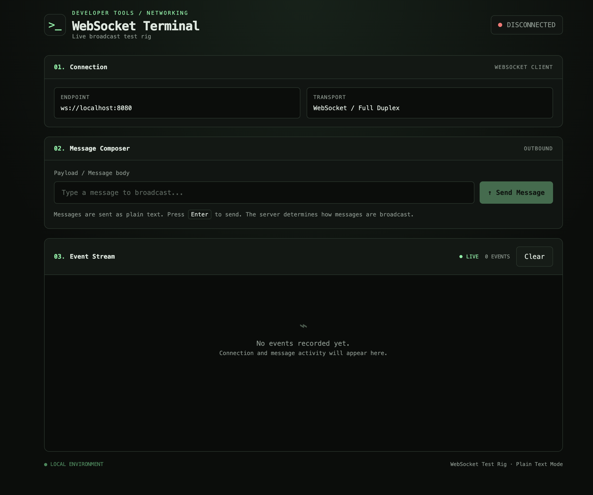
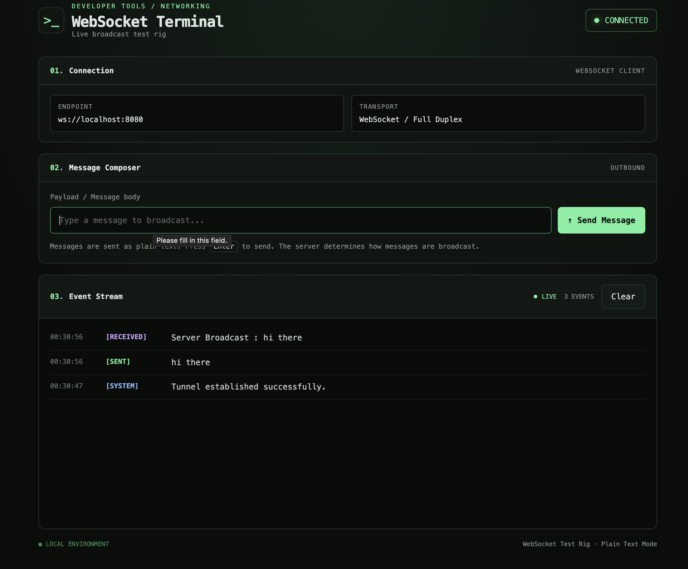

# WebSocket Terminal — Live Broadcast Test Rig

A lightweight, browser-based WebSocket client for testing real-time, bidirectional communication. The terminal-inspired interface shows connection status, lets you send text messages, and displays sent, received, and system events in a live log.

> **Endpoint:** `ws://localhost:8080`  
> **Mode:** Plain-text messages  
> **Purpose:** Local development and learning

## Preview

### Disconnected state



### Connected state with message activity



To use these previews, save your screenshots in a `screenshots/` folder with the filenames shown above, or update the image paths to match your own filenames.

## Features

- **Connection status** — displays whether the WebSocket is connecting, connected, or disconnected.
- **Send messages** — send plain-text messages to the WebSocket server.
- **Receive messages** — view messages delivered by the server.
- **Event log** — distinguishes `[SYSTEM]`, `[SENT]`, `[RECEIVED]`, and `[ERROR]` events.
- **Timestamps** — each event includes the local time when it was logged.
- **Clear logs** — clears the visible log without closing the connection.
- **Input validation** — blocks empty or whitespace-only messages.
- **Connection checks** — prevents sending when the socket is not open.
- **Responsive dark UI** — a terminal-inspired interface for desktop and smaller screens.

## What is a WebSocket?

A **WebSocket** is a communication protocol that lets a client and server exchange data over a single, long-lived connection.

With a typical HTTP request, the client sends a request and the server sends a response. For many traditional interactions, the client must make another request to ask for new information.

With WebSockets, the connection stays open after the initial handshake. Once connected, **either side can send a message whenever it needs to** without starting a new HTTP request for every message.

### HTTP vs WebSocket

```text
HTTP (typical request/response)
-------------------------------

Client                         Server
  |                               |
  |-------- HTTP request -------->|
  |<------- HTTP response --------|
  |                               |
  |-------- HTTP request -------->|
  |<------- HTTP response --------|
  |                               |
  |   Another request is needed   |
  |   to ask for more information |


WebSocket (persistent connection)
---------------------------------

Client                         Server
  |                               |
  |---- HTTP Upgrade request ---->|
  |<--- Upgrade accepted ---------|
  |                               |
  |<====== Connection stays =====>|
  |                               |
  |-------- Message ------------->|
  |<------- Message --------------|
  |<------- Message --------------|
  |-------- Message ------------->|
  |                               |
  |   Both sides can send data    |
  |   until the connection closes |
```

**Important:** HTTP is not inherently limited to one response, and technologies such as Server-Sent Events can stream server-to-client updates. WebSockets are useful when you want bidirectional communication over one persistent connection.

## How a WebSocket connection works

### 1. The browser creates a WebSocket

The frontend runs:

```js
const socket = new WebSocket("ws://localhost:8080");
```

This asks the browser to connect to a WebSocket server listening at `localhost` on port `8080`.

- `ws://` means WebSocket without transport encryption.
- `wss://` means WebSocket secured with TLS, similar to HTTPS.
- `localhost` means the same machine as the browser.
- `8080` is the server port.

The constructor starts the connection process; it does not mean the connection is already ready.

### 2. The browser and server perform a handshake

WebSockets commonly begin with an HTTP-based handshake. The browser requests an upgrade from HTTP to WebSocket, and a compatible server accepts it.

```text
Browser                                  WebSocket server
   |                                            |
   |  HTTP GET + Upgrade: websocket             |
   |------------------------------------------->|
   |                                            |
   |  HTTP 101 Switching Protocols              |
   |<-------------------------------------------|
   |                                            |
   |=========== WebSocket connection ===========|
   |                                            |
```

After a successful handshake, both sides can exchange WebSocket frames over the established connection. The browser's WebSocket API handles the protocol details; you normally do not write the handshake yourself.

### 3. The connection remains open

The browser receives lifecycle events:

| Event | Meaning |
|---|---|
| `open` | The connection has been established. |
| `message` | A message has arrived from the server. |
| `error` | A connection or communication error was reported. |
| `close` | The connection has closed. |

The UI updates its status when the `open` or `close` event fires. It also adds system and error events to the log.

### 4. The client sends a message

When you submit the form, the frontend:

1. Reads the input and trims whitespace.
2. Rejects an empty message.
3. Checks that `socket.readyState === WebSocket.OPEN`.
4. Calls `socket.send(message)`.
5. Adds a `[SENT]` entry to the local log.

```text
User types a message
        |
        v
Trim and validate input
        |
        v
Is the socket OPEN?
    /           \
  No             Yes
  |               |
Log an error    socket.send(message)
                  |
                  v
             Add [SENT] entry
```

A `[SENT]` entry means the browser accepted the message for sending. It does **not**, by itself, prove that the server processed the message or that another client received it.

### 5. The server sends a message back

When the browser receives a WebSocket message, its `message` event fires. This project displays the received data as a `[RECEIVED]` log entry.

For example:

```text
[SENT]      hi there
[RECEIVED]  Server Broadcast : hi there
```

The received text is determined by your backend. The example above suggests that the server broadcasts a message with a prefix, but the frontend does not create that server response itself.

## How broadcasting works

WebSocket provides the persistent connection and message transport. **Broadcasting is application logic implemented by your server.** A WebSocket server may send a message back only to the sender, to selected clients, or to every connected client, depending on its code.

A typical broadcast server might work like this:

```text
                   WebSocket Server
                 (localhost:8080)
                         |
            +------------+------------+
            |            |            |
            v            v            v
         Client A     Client B     Client C
            |            |            |
            |-- "Hi" --->|            |
            |----------->|-----------> |
            |            |            |
            |     Server broadcasts   |
            |       to connected      |
            |         clients          |
```

A more detailed flow:

1. Client A connects to the server.
2. Clients B and C also connect.
3. Client A sends a message.
4. The server receives and processes the message.
5. If the server's logic broadcasts it, the server sends a message to the intended clients.
6. Each receiving browser fires its own `message` event and displays the payload.

The exact recipients depend on the server implementation. Some servers intentionally exclude the sender from broadcasts; others send the message to every client, including the sender.

## How this project is structured

This test rig is a single HTML page containing three main parts:

```text
+--------------------------------------------------+
|                 WebSocket Terminal               |
+--------------------------------------------------+
|  01. Connection                                  |
|      Endpoint + transport information            |
+--------------------------------------------------+
|  02. Message Composer                            |
|      Text input + Send button                    |
+--------------------------------------------------+
|  03. Event Stream                                |
|      Timestamps + sent/received/system/error logs|
+--------------------------------------------------+
                         |
                         | WebSocket
                         v
                ws://localhost:8080
                         |
                         v
                  Your WebSocket server
```

### Frontend responsibilities

- Opens the connection using the browser's `WebSocket` API.
- Updates the connection indicator.
- Sends user-entered plain-text messages.
- Receives server messages.
- Logs events and timestamps.
- Validates input and connection state.

### Backend responsibilities

The WebSocket server must:

- Listen on the expected port.
- Accept WebSocket upgrade requests.
- Handle incoming messages.
- Decide whether and how to broadcast messages.
- Close connections and handle errors appropriately.

This HTML page does not include a WebSocket server. You must run your own server separately.

## Getting started

### Requirements

- A modern browser with WebSocket support.
- A WebSocket server listening at `ws://localhost:8080`.
- A local copy of this HTML file.

### 1. Start your WebSocket server

Start your backend using the command appropriate for your project. Make sure it listens on port `8080`.

For example, if your server project uses npm scripts:

```bash
npm install
npm run dev
```

These commands are examples; use the scripts defined in your server's `package.json`.

### 2. Open the HTML page

You can open the HTML file directly in a browser for local testing, or serve it using a local static-file server.

The page attempts to connect to:

```text
ws://localhost:8080
```

If your backend runs on a different port or host, update the URL in the JavaScript:

```js
const socket = new WebSocket("ws://localhost:8080");
```

### 3. Test the connection

1. Open the page.
2. Confirm that the status changes from `CONNECTING` to `CONNECTED`.
3. Enter a non-empty message such as `hi there`.
4. Press **Enter** or click **Send Message**.
5. Check the `[SENT]` entry.
6. Check for a `[RECEIVED]` entry if your server sends a response or broadcast.
7. Open the same page in another browser tab to test multi-client broadcasting, if the backend supports it.

### 4. Clear the event log

Click **Clear** to remove visible log entries and reset the event count. This action does not close or recreate the WebSocket connection. New events will appear as they occur.

## Key browser API concepts

### `readyState`

`socket.readyState` tells you the current state of the connection.

| Constant | Value | Meaning |
|---|---:|---|
| `WebSocket.CONNECTING` | `0` | The connection is being established. |
| `WebSocket.OPEN` | `1` | The connection is ready for communication. |
| `WebSocket.CLOSING` | `2` | The connection is closing. |
| `WebSocket.CLOSED` | `3` | The connection is closed or could not be opened. |

Check for `WebSocket.OPEN` before calling `send()`:

```js
if (socket.readyState !== WebSocket.OPEN) {
    // The socket is not ready.
    return;
}

socket.send(message);
```

### `send()`

`socket.send(data)` queues data to be transmitted over the WebSocket connection. This project sends strings, so the payload is plain text.

The browser API also supports other payload types, including `Blob`, `ArrayBuffer`, and typed arrays.

### `message` event

```js
socket.addEventListener("message", (event) => {
    console.log(event.data);
});
```

The `event.data` value contains the received payload. Its type depends on what the other side sent and the WebSocket configuration.

### `close()` and cleanup

A connection can close because the server shuts down, the network fails, or either side initiates a closing handshake. A production application should consider when to reconnect, how to avoid duplicate listeners, and how to clean up resources.

This test rig reports connection errors and closure but does not automatically reconnect.

## Troubleshooting

### Status stays on `CONNECTING` or changes to `DISCONNECTED`

- Make sure the WebSocket server is running.
- Confirm that the server uses port `8080`.
- Check the browser DevTools Console and Network panel.
- Verify that the server accepts WebSocket upgrade requests at the root path `/`.
- Ensure the URL matches your server's host, port, and path.

### The message is sent but nothing is received

- Confirm that the server has a `message` handler.
- Check whether the backend sends a response or broadcasts to clients.
- Open another client if the server broadcasts only to other connected clients.
- Inspect server logs for received messages or exceptions.

### The browser reports a security or mixed-content error

If the page is loaded over HTTPS, browsers generally block an insecure `ws://` connection as mixed content. Use `wss://` with a TLS-enabled WebSocket server in that situation.

### `localhost` points to the wrong machine

`localhost` refers to the machine where the browser is running. If your server is in a container, virtual machine, or another computer, you may need a different reachable hostname or port mapping.

### The server closes the connection

Check the close code and reason shown in the event log. Also inspect server logs to determine whether the server intentionally closed the connection or encountered an error.

## Security notes

- Use `wss://` in production to encrypt traffic in transit.
- Validate and authorize clients on the server; a WebSocket connection is not authentication by itself.
- Validate incoming payloads and limit message sizes on the server.
- Consider checking the browser `Origin` on the server to help prevent unwanted cross-origin WebSocket connections. Origin checks are not a substitute for authentication.
- Never put secrets or credentials in frontend JavaScript.
- Do not expose a development WebSocket server publicly without appropriate access controls.

## Limitations

- This is a browser-side test client, not a WebSocket server.
- The endpoint is hardcoded to `ws://localhost:8080`.
- Messages are sent as plain text.
- The UI does not automatically reconnect after disconnection.
- The `[SENT]` log indicates a send attempt through an open socket, not guaranteed delivery or processing.
- Broadcast behavior depends on the backend implementation.

## Further reading

- [MDN: The WebSocket API](https://developer.mozilla.org/en-US/docs/Web/API/WebSocket)
- [MDN: Writing WebSocket client applications](https://developer.mozilla.org/en-US/docs/Web/API/WebSockets_API/Writing_WebSocket_client_applications)
- [RFC 6455: The WebSocket Protocol](https://www.rfc-editor.org/rfc/rfc6455)

---

**Built for learning and testing real-time WebSocket communication.**
